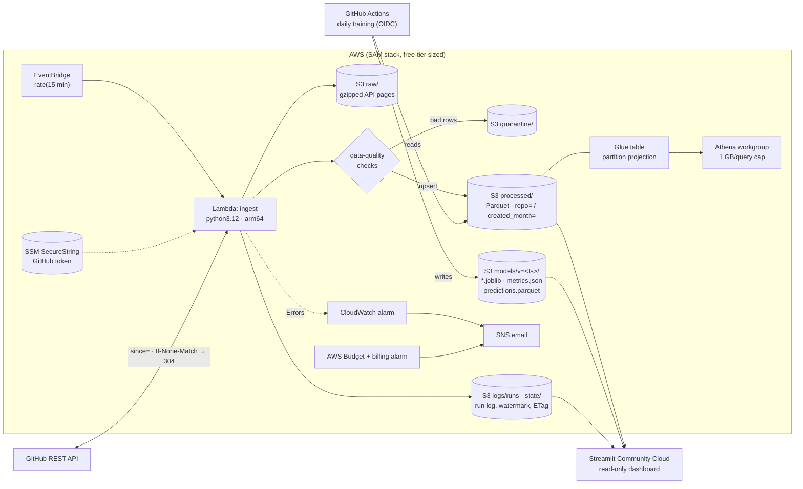

# Defect Analysis Dashboard

Near-real-time defect analytics for **microsoft/vscode** and **react/react** GitHub issues:
an incremental ingestion pipeline on AWS (Lambda + S3 data lake + Glue/Athena), an offline
ML training job with honest time-based evaluation, and a Streamlit dashboard that only
*reads* the lake and saved models.

> Measured results, with the commands that reproduce them, are in **[RESULTS.md](RESULTS.md)**.

## Architecture



**Ingestion (every 15 min).** For each repo, the Lambda calls
`GET /repos/{repo}/issues?state=all&sort=updated&direction=asc&since=<watermark − 5 min>`.
The watermark only moves when data changes, so an idle repo is polled with the same URL and
`If-None-Match`, and gets a `304 Not Modified`. Authenticated 304s don't count against the
rate limit. Pages are written unmodified to `raw/` (replayable), then cleaned, checked and
upserted into `processed/`. The watermark advances only after the Parquet write succeeds, so
the pipeline is at-least-once and idempotent. Backfill uses the same loop: each run is capped
at `MAX_PAGES_PER_RUN`, and the next run resumes from the watermark.

**Data quality.** These are checked on every batch:
- schema and dtypes (fatal)
- nulls in key fields
- valid `state`
- `closed_at >= created_at`
- duplicate `(repo, issue_id)`
- warn-level checks

Bad rows are quarantined with a reason. Each run log records records ingested, duration,
API calls (billable vs 304), DQ results, latency and failures.

**ML (offline, daily).** `python -m ml.train` reads the lake and trains three models. It
evaluates each against a naive baseline on the same chronological hold-out (train on older
issues, test on newer), then refits on all data and writes versioned artifacts:
- RandomForestRegressor: resolution days, capped at 90 and censoring-aware.
- LogisticRegression: resolution bucket (`<1d`, `1–7d`, `7–30d`, `>30d`).
- TF-IDF + LogisticRegression: category.

It also batch-scores the lake so the dashboard doesn't re-score issues on load. Only
creation-time features are used. Labels and comment counts are added later during triage,
so they're kept in a leakage ablation only.

**Dashboard.** Four tabs: Overview, Predictions (open issues), Pipeline health (freshness,
lag, record counts, API usage, DQ, latency) and Model metrics (baselines, confusion
matrices). It makes no GitHub calls and does no training.

## Repository layout

```
common/      storage.py (S3/local Store over boto3) · config.py · runlog.py
ingestion/   github_client.py (since/ETag/pagination/backoff) · handler.py (Lambda) · state.py · run.py (CLI)
transform/   clean.py · labels.py (category/severity rules) · quality.py (DQ) · lake.py (Parquet upsert)
ml/          features.py · labels.py (bucket/censoring) · evaluate.py · models.py · train.py · predict.py
app/         streamlit_app.py · data.py (cached, read-only) · views.py
infra/       template.yaml (SAM) · bootstrap.yaml (GitHub OIDC roles) · samconfig.toml
benchmarks/  cold_load.py · schedule_local.py · summarize_runs.py · report_tables.py · legacy_app.py · results/
tests/       99 tests: unit + moto (S3/SSM) + responses (GitHub) + training smoke + headless app render
.github/     ci.yml (PRs) · deploy.yml (main) · train.yml (daily)
```

Everything is plain Python packages with environment-variable configuration (`DATA_URI`,
`REPOS`, …), so containerizing later means a Dockerfile around the existing entry points:
`ingestion.handler.lambda_handler`, `python -m ml.train` and `streamlit run app/streamlit_app.py`.

## Quickstart (local, no AWS needed)

```bash
python3.12 -m venv .venv && source .venv/bin/activate
make install                                   # requirements.txt + requirements-dev.txt
echo "GITHUB_TOKEN=<token, no scopes needed>" > .env

python -m ingestion.run --store data --until-caught-up --max-pages 100   # 365-day backfill (~6 min)
python -m ml.train --store data                                          # ~2.3 min on an M1 (incl. batch scoring)
DATA_URI=data streamlit run app/streamlit_app.py

make lint && make test                         # ruff + pytest with coverage
```

## Deploy to AWS

Prerequisites: AWS CLI v2, SAM CLI and an account. All resources fit the free tier; see *Cost*.

```bash
# 1. GitHub token in SSM Parameter Store (SecureString: free, unlike Secrets Manager)
aws ssm put-parameter --name /defect-dashboard/github-token --type SecureString --value "<token>"

# 2. Deploy the stack (Lambda, schedule, S3, Glue, Athena, alarms, budget)
make deploy ALERT_EMAIL=you@example.com        # = make package + sam build + sam deploy

# 3. (optional) CI/CD: GitHub OIDC roles, then set repo variables
make bootstrap GITHUB_REPO=<owner>/<repo>
#    AWS_DEPLOY_ROLE_ARN, AWS_TRAIN_ROLE_ARN (stack outputs), AWS_REGION, DATA_URI=s3://<bucket>, ALERT_EMAIL

# 4. Backfill faster than the 40-pages-per-15-min schedule (optional), then train once
python -m ingestion.run --store s3://<bucket> --until-caught-up --max-pages 100
python -m ml.train --store s3://<bucket>
```

Query the lake with Athena (workgroup `defect-dashboard`, database `defect_dashboard_lake`):

```sql
SELECT repo, created_month, count(*) AS issues,
       approx_percentile(resolution_days, 0.5) AS p50_days
FROM issues
WHERE created_month >= '2026-01'
GROUP BY 1, 2 ORDER BY 1, 2;
```

`repo` and `created_month` are projected partitions, so there's no crawler or `MSCK REPAIR`.
`repo` values use `owner__name`.

### Dashboard on Streamlit Community Cloud

1. New app → this repo, branch `main`, main file `app/streamlit_app.py`. Python 3.12.
   Dependencies come from the pinned `requirements.txt`.
2. Create keys for the read-only IAM user the stack creates:
   `aws iam create-access-key --user-name defect-dashboard-dashboard-reader`
3. Paste `.streamlit/secrets.toml.example` into the app's Secrets, with real values.

The reader can only `GetObject` on `processed/`, `models/`, `logs/` and `state/`.

## CI/CD

| Workflow | Trigger | What it does |
|---|---|---|
| `ci.yml` | every PR (and as the gate in `deploy.yml`) | `ruff check` + `ruff format --check`; `pytest` with coverage (fails < 85%); `sam validate --lint` on both templates; `sam build` |
| `deploy.yml` | push to `main` | runs CI, then `sam deploy` via OIDC (no stored AWS keys) and smoke-invokes the Lambda. Skipped until `AWS_DEPLOY_ROLE_ARN` is set |
| `train.yml` | daily 06:17 UTC + manual | trains on the S3 lake with a least-privilege OIDC role and publishes `models/v=<ts>/` |

Training runs in GitHub Actions rather than Lambda because pandas + pyarrow + scikit-learn
exceed Lambda's 250 MB zip limit, and container images are out of scope for now.

## Cost and teardown

Designed to round to **$0/month** on a free-tier account:
- **Lambda:** 2,880 invocations a month at 512 MB, arm64. The 1M-request and 400k GB-s free
  tier covers it.
- **S3:** tens of MB, with lifecycle expiry on `raw/`, `quarantine/`, `logs/` and
  `athena-results/`.
- **SSM:** standard parameters are free.
- **Glue Data Catalog:** first million objects free. Partition projection means no crawler.
- **Athena:** $5/TB scanned, with a 1 GB per-query cap enforced by the workgroup.
- **CloudWatch:** 14-day log retention; 2 alarms (free tier: 10).
- **Guardrails:** an AWS Budget (default $1) with email at 50% actual / 100% forecast, plus a
  `EstimatedCharges` billing alarm in us-east-1. The billing alarm needs "Receive Billing
  Alerts" enabled in account settings.

```bash
make teardown        # empties the bucket, deletes both stacks and the SSM parameter. Irreversible.
```

## Known limitations

- The models are modest. Resolution time is driven by triage decisions that the text at
  creation time barely reveals, and there's measurable drift between periods. Details and
  next steps are in [RESULTS.md](RESULTS.md#weak-results-and-next-steps).
- Categories are weak labels derived from area labels. About two thirds of issues have no
  mappable area label (`Other`), which is why the NLP category model exists.
- The deployed stack hasn't been benchmarked yet. All measurements in RESULTS.md come from
  running the same code against a local lake.

## Author

**Abhinav Binu**, Computer Science @ UT Dallas
